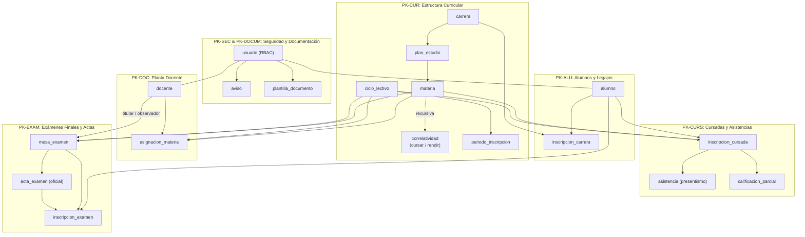

# Propuesta de Base de Datos Institucional — ISFT 189

**Proyecto:** Sistema Integral de Gestión Académica Global  
**Institución:** Instituto Superior de Formación Técnica N° 189 (ISFT 189)  
**Alcance:** Estructura académica, administrativa y curricular global del instituto basada en la documentación formal de **Casos de Uso (CU-01 a CU-44)** y **Diagramas de Clases (PK-SEC, PK-CUR, PK-ALU, PK-DOC, PK-CURS, PK-EXAM, PK-DOCUM)**.  
**Estándar de Nomenclatura:** Tablas y entidades **100% en SINGULAR**.  
**Arquitectura Modular:** La capa conversacional, embeddings y consultas del Asistente Virtual se gestionan en [`db/bot`](file:///home/marcosdima/Desktop/Institut/Segundo%20año/Analisis%20de%20sitemas/integrador/análisis-2/db/bot), referenciando a la tabla `usuario` de este esquema institucional.

---

## Archivos de la Propuesta

| Archivo | Descripción |
|---|---|
| [`modelo.dbml`](file:///home/marcosdima/Desktop/Institut/Segundo%20año/Analisis%20de%20sitemas/integrador/análisis-2/db/instituto/modelo.dbml) | Especificación en **DBML** estructurada y normalizada: enums, tablas en singular, índices, notas descriptivas y agrupación visual por `TableGroup` (compatible con [dbdocs.io](https://dbdocs.io) y [dbdiagram.io](https://dbdiagram.io)). |
| [`er.drawio`](file:///home/marcosdima/Desktop/Institut/Segundo%20año/Analisis%20de%20sitemas/integrador/análisis-2/db/instituto/er.drawio) | Diagrama **Entidad-Relación (E-R)** completo en XML estándar de Diagrams.net / Draw.io, organizado por zonas funcionales con entidades, relaciones y cardinalidades. Se abre en VS Code con *Draw.io Integration* o en <https://app.diagrams.net>. |
| [`01_ddl.sql`](file:///home/marcosdima/Desktop/Institut/Segundo%20año/Analisis%20de%20sitemas/integrador/análisis-2/db/instituto/01_ddl.sql) | Script **DDL** reejecutable para PostgreSQL 16+: crea el esquema `instituto`, 11 tipos `ENUM`, 18 tablas en singular con restricciones de integridad (`PRIMARY KEY`, `FOREIGN KEY`, `UNIQUE`, `CHECK`), índices B-Tree y comentarios (`COMMENT ON`). |
| [`02_dml.sql`](file:///home/marcosdima/Desktop/Institut/Segundo%20año/Analisis%20de%20sitemas/integrador/análisis-2/db/instituto/02_dml.sql) | Script **DML** transaccional con datos de prueba realistas para la carrera *Tecnicatura Superior en Análisis de Sistemas* + **8 consultas SQL de validación** que comprueban los Casos de Uso del sistema. |

---

## Cobertura de Requisitos Funcionales y Casos de Uso



| Módulo / Paquete | Casos de Uso Respaldados | Tablas Relacionales (Singular) |
|---|---|---|
| **PK-SEC: Seguridad y Acceso** | CU-01 (*Iniciar sesión*), CU-02 (*Recuperar contraseña*), CU-03 (*Asignar roles*), CU-04 (*Publicar avisos*) | `usuario`, `aviso` |
| **PK-CUR: Estructura Curricular** | CU-05 (*Registrar carrera*), CU-06 (*Modificar carrera*), CU-07 (*Plan de estudios*), CU-08 (*Materia*), CU-09 (*Correlatividades*), CU-10 (*Ciclo lectivo y períodos*) | `carrera`, `plan_estudio`, `materia`, `correlatividad`, `ciclo_lectivo`, `periodo_inscripcion` |
| **PK-ALU: Alumnos y Legajos** | CU-11 a CU-14 (*Legajo de alumno*), CU-15 (*Inscribir a carrera*), CU-16 (*Historia académica*) | `alumno`, `inscripcion_carrera` |
| **PK-DOC: Planta Docente** | CU-17 y CU-18 (*Legajo docente*), CU-19 (*Asignar a materia*), CU-20 a CU-23 (*Nóminas y mesas asignadas*) | `docente`, `asignacion_materia` |
| **PK-CURS: Cursadas y Asistencias** | CU-24 y CU-25 (*Inscripción ordinaria y fuera de término*), CU-26 (*Validación correlatividades*), CU-27 (*Anulación*), CU-28 y CU-29 (*Asistencias*), CU-30 a CU-32 (*Notas parciales y condición final*), CU-33 y CU-34 (*Planillas consolidadas*) | `inscripcion_cursada`, `asistencia`, `calificacion_parcial` |
| **PK-EXAM: Exámenes y Actas** | CU-35 (*Programar mesa*), CU-36 a CU-39 (*Inscripción y validación*), CU-40 a CU-42 (*Generación, carga de notas y cierre de acta oficial*) | `mesa_examen`, `acta_examen`, `inscripcion_examen` |
| **PK-DOCUM: Gestión Documental** | CU-43 (*Cargar plantilla oficial*), CU-44 (*Consultar plantillas*) | `plantilla_documento` |

---

## Diccionario de Tablas (Nomenclatura en Singular)

1. **`usuario`**: Cuentas institucionales con password hash (bcrypt), estado y rol (`ALUMNO`, `DOCENTE`, `PRECEPTOR`, `ADMINISTRADOR`).
2. **`aviso`**: Comunicados de administración para toda la comunidad (`dirigido_a IS NULL`) o segmentados por rol.
3. **`carrera`**: Carreras terciarias técnicas del instituto.
4. **`plan_estudio`**: Estructuras curriculares oficiales asociadas a una carrera y año de resolución.
5. **`materia`**: Unidades curriculares con año (`1..5`) y carga horaria.
6. **`correlatividad`**: Requisitos entre materias (`PARA_CURSAR` o `PARA_RENDIR`).
7. **`ciclo_lectivo`**: Años calendario académicos con estado (`ABIERTO`, `CERRADO`).
8. **`periodo_inscripcion`**: Ventanas de inscripción ordinaria a cursadas y exámenes finales.
9. **`alumno`**: Legajo único, DNI, datos de contacto y estado (`ACTIVO`, `BAJA`).
10. **`inscripcion_carrera`**: Matriculación formal del alumno a la tecnicatura.
11. **`docente`**: Legajo docente, CUIL y cuenta de usuario vinculada.
12. **`asignacion_materia`**: Cátedras designadas con cargo (`TITULAR`, `OBSERVADOR`) por ciclo lectivo.
13. **`inscripcion_cursada`**: Registro en aula con condición final (`CURSANDO`, `REGULAR`, `PROMOCIONADO`, `LIBRE`) y flag `fuera_de_termino`.
14. **`asistencia`**: Presentismo clase a clase para cómputo de porcentaje de asistencia.
15. **`calificacion_parcial`**: Notas de parciales y trabajos prácticos (1 a 10).
16. **`mesa_examen`**: Turnos de examen final con tribunal asignado (docente titular y observador).
17. **`acta_examen`**: Acta oficial digital; al pasar a `CERRADA` queda inmutable con fecha de cierre.
18. **`inscripcion_examen`**: Alumnos inscriptos, nota final y estado (`INSCRIPTO`, `ANULADO`).
19. **`plantilla_documento`**: Repositorio de modelos en blanco descargables (constancias, actas modelo).

---

## Instrucciones de Ejecución

### Opción A: PostgreSQL Local
```bash
# 1. Crear el esquema y las tablas en singular
psql -d postgres -v ON_ERROR_STOP=1 -f db/instituto/01_ddl.sql

# 2. Cargar datos de prueba y ejecutar las 8 consultas de validación
psql -d postgres -v ON_ERROR_STOP=1 -f db/instituto/02_dml.sql
```

### Opción B: Mediante Docker
```bash
docker exec -i pg-isft189 psql -U postgres -v ON_ERROR_STOP=1 < db/instituto/01_ddl.sql
docker exec -i pg-isft189 psql -U postgres -v ON_ERROR_STOP=1 < db/instituto/02_dml.sql
```
