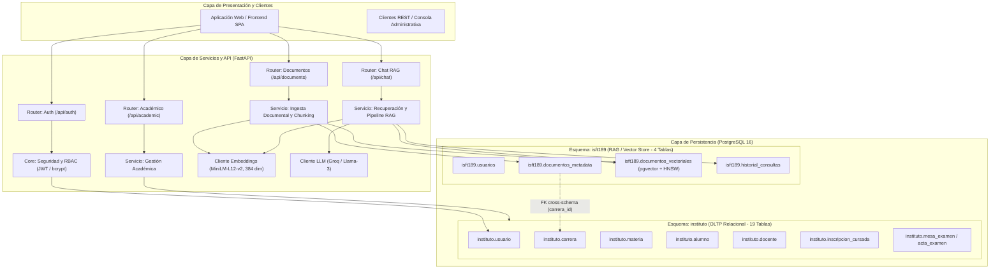
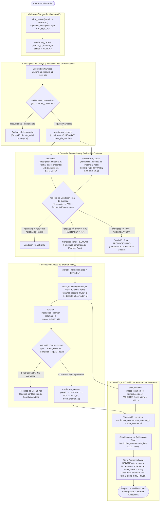

# ESPECIFICACIÓN TÉCNICA DE MODELADO RELACIONAL, VECTORIAL Y DICCIONARIO DE DATOS
## SISTEMA INTEGRAL DE GESTIÓN ACADÉMICA Y ASISTENTE VIRTUAL INTELIGENTE (RAG) — ISFT 189

---

### 1. ARQUITECTURA GENERAL DEL SISTEMA

El sistema integra un motor relacional transaccional y vectorial sobre PostgreSQL 16+, desacoplado en dos esquemas funcionales: `instituto` (gestión académica OLTP) e `isft189` (almacenamiento vectorial y auditoría de asistencia inteligente). El backend en FastAPI proporciona servicios de autenticación RBAC, transacciones académicas, ingesta documental con tokenización/chunking y un pipeline RAG soportado por embeddings densos de 384 dimensiones (`paraphrase-multilingual-MiniLM-L12-v2`) con inferencia vía Groq LLM.



---

### 2. DIAGRAMA ENTIDAD-RELACIÓN DEL ESQUEMA `instituto` (ORGANIZADO POR CLUSTERS FUNCIONALES)

El esquema `instituto` modela el dominio académico institucional formalizado en 19 tablas estructuradas en 7 clusters de cohesión funcional.

```mermaid
flowchart TD
    classDef seguridad fill:#e3f2fd,stroke:#1565c0,stroke-width:1.5px;
    classDef curricular fill:#e8f5e9,stroke:#2e7d32,stroke-width:1.5px;
    classDef legajos fill:#f3e5f5,stroke:#7b1fa2,stroke-width:1.5px;
    classDef cursadas fill:#fff3e0,stroke:#e65100,stroke-width:1.5px;
    classDef examenes fill:#fbe9e7,stroke:#c2185b,stroke-width:1.5px;
    classDef documental fill:#eceff1,stroke:#455a64,stroke-width:1.5px;

    subgraph SEC["1. Cluster: Seguridad y Accesos"]
        usuario["instituto.usuario<br/>-------------------<br/>PK: id<br/>UQ: email<br/>rol: rol_usuario<br/>activo: BOOLEAN"]:::seguridad
        aviso["instituto.aviso<br/>-------------------<br/>PK: id<br/>FK: publicado_por_id<br/>dirigido_a: rol_usuario"]:::seguridad
    end

    subgraph CUR["2. Cluster: Estructura Curricular y Calendario"]
        carrera["instituto.carrera<br/>-------------------<br/>PK: id<br/>UQ: nombre<br/>activa: BOOLEAN"]:::curricular
        plan_estudio["instituto.plan_estudio<br/>-------------------<br/>PK: id<br/>FK: carrera_id<br/>UQ: (carrera_id, anio)<br/>vigente: BOOLEAN"]:::curricular
        materia["instituto.materia<br/>-------------------<br/>PK: id<br/>FK: plan_estudio_id<br/>UQ: (plan_estudio_id, nombre)<br/>anio_en_plan: INT (1..5)"]:::curricular
        correlatividad["instituto.correlatividad<br/>-------------------<br/>PK: id<br/>FK: materia_id<br/>FK: materia_correlativa_id<br/>tipo: tipo_correlatividad<br/>UQ: (materia, req, tipo)"]:::curricular
        ciclo_lectivo["instituto.ciclo_lectivo<br/>-------------------<br/>PK: id<br/>UQ: anio<br/>estado: estado_ciclo"]:::curricular
        periodo_inscripcion["instituto.periodo_inscripcion<br/>-------------------<br/>PK: id<br/>FK: ciclo_lectivo_id<br/>tipo: tipo_periodo<br/>rango: inicio..fin"]:::curricular
    end

    subgraph ALU["3. Cluster: Legajos de Alumnos"]
        alumno["instituto.alumno<br/>-------------------<br/>PK: id<br/>FK, UQ: usuario_id<br/>UQ: legajo, dni<br/>estado: estado_alumno"]:::legajos
        inscripcion_carrera["instituto.inscripcion_carrera<br/>-------------------<br/>PK: id<br/>FK: alumno_id<br/>FK: carrera_id<br/>UQ: (alumno_id, carrera_id)"]:::legajos
    end

    subgraph DOC["4. Cluster: Planta Docente y Cátedras"]
        docente["instituto.docente<br/>-------------------<br/>PK: id<br/>FK, UQ: usuario_id<br/>UQ: legajo, cuil"]:::legajos
        asignacion_materia["instituto.asignacion_materia<br/>-------------------<br/>PK: id<br/>FK: docente_id<br/>FK: materia_id<br/>FK: ciclo_lectivo_id<br/>cargo: cargo_docente"]:::legajos
    end

    subgraph CURS["5. Cluster: Cursadas, Asistencias y Calificaciones"]
        inscripcion_cursada["instituto.inscripcion_cursada<br/>-------------------<br/>PK: id<br/>FK: materia_id<br/>FK: alumno_id<br/>FK: ciclo_lectivo_id<br/>condicion: condicion_cursada"]:::cursadas
        asistencia["instituto.asistencia<br/>-------------------<br/>PK: id<br/>FK: inscripcion_cursada_id<br/>UQ: (cursada_id, fecha_clase)"]:::cursadas
        calificacion_parcial["instituto.calificacion_parcial<br/>-------------------<br/>PK: id<br/>FK: inscripcion_cursada_id<br/>instancia: instancia_evaluacion<br/>UQ: (cursada_id, inst, nro)"]:::cursadas
    end

    subgraph EXAM["6. Cluster: Mesas de Examen y Actas Oficiales"]
        mesa_examen["instituto.mesa_examen<br/>-------------------<br/>PK: id<br/>FK: materia_id<br/>FK: ciclo_lectivo_id<br/>FK: docente_titular_id<br/>FK: docente_observador_id"]:::examenes
        acta_examen["instituto.acta_examen<br/>-------------------<br/>PK: id<br/>FK, UQ: mesa_examen_id<br/>UQ: numero<br/>estado: estado_acta"]:::examenes
        inscripcion_examen["instituto.inscripcion_examen<br/>-------------------<br/>PK: id<br/>FK: mesa_examen_id<br/>FK: alumno_id<br/>FK: acta_examen_id<br/>UQ: (alumno_id, mesa_id)"]:::examenes
    end

    subgraph DOCUM["7. Cluster: Repositorio Documental"]
        plantilla_documento["instituto.plantilla_documento<br/>-------------------<br/>PK: id<br/>FK: cargada_por_usuario_id<br/>tipo_acta: VARCHAR(100)"]:::documental
    end

    usuario -->|1:N| aviso
    usuario -->|1:1| alumno
    usuario -->|1:1| docente
    usuario -->|1:N| plantilla_documento

    carrera -->|1:N| plan_estudio
    plan_estudio -->|1:N| materia
    materia -->|1:N| correlatividad
    materia -->|1:N (Requisito)| correlatividad
    ciclo_lectivo -->|1:N| periodo_inscripcion

    alumno -->|1:N| inscripcion_carrera
    carrera -->|1:N| inscripcion_carrera

    docente -->|1:N| asignacion_materia
    materia -->|1:N| asignacion_materia
    ciclo_lectivo -->|1:N| asignacion_materia

    materia -->|1:N| inscripcion_cursada
    alumno -->|1:N| inscripcion_cursada
    ciclo_lectivo -->|1:N| inscripcion_cursada
    inscripcion_cursada -->|1:N| asistencia
    inscripcion_cursada -->|1:N| calificacion_parcial

    materia -->|1:N| mesa_examen
    ciclo_lectivo -->|1:N| mesa_examen
    docente -->|1:N (Titular)| mesa_examen
    docente -.->|0..1:N (Observador)| mesa_examen
    mesa_examen -->|1:1| acta_examen
    mesa_examen -->|1:N| inscripcion_examen
    alumno -->|1:N| inscripcion_examen
    acta_examen -->|1:N| inscripcion_examen
```

---

### 3. DIAGRAMA ENTIDAD-RELACIÓN DEL ESQUEMA `isft189` (RAG, pgvector Y AUDITORÍA)

El esquema `isft189` almacena el catálogo documental institucional, los embeddings semánticos vectorizados a 384 dimensiones bajo la extensión `vector` de PostgreSQL y el log de auditoría del asistente.

```mermaid
erDiagram
    instituto_carrera ||--o{ isft189_documentos_metadata : "carrera_id (FK cross-schema)"
    isft189_documentos_metadata ||--|{ isft189_documentos_vectoriales : "documento_id (CASCADE)"
    isft189_usuarios ||--o{ isft189_historial_consultas : "usuario_id (SET NULL)"

    instituto_carrera {
        bigint id PK
        varchar nombre UQ
        varchar titulo_otorgado
        boolean activa
    }

    isft189_usuarios {
        bigserial id PK
        varchar nombre
        varchar email UQ
        varchar rol
        timestamptz fecha_registro
    }

    isft189_documentos_metadata {
        bigserial id PK
        varchar titulo
        tipo_documento tipo_documento
        timestamptz fecha_subida
        bigint carrera_id FK
        boolean activo
    }

    isft189_documentos_vectoriales {
        bigserial id PK
        bigint documento_id FK
        text contenido
        jsonb metadata
        vector_384 embedding
        timestamptz fecha_creacion
    }

    isft189_historial_consultas {
        bigserial id PK
        bigint usuario_id FK
        text pregunta
        text respuesta
        timestamptz fecha_consulta
    }
```

```mermaid
flowchart LR
    subgraph CROSS_SCHEMA["Interoperabilidad Inter-Esquema"]
        CARRERA["instituto.carrera<br/>PK: id<br/>nombre: VARCHAR(150)"]
    end

    subgraph ISFT189["Esquema isft189 (Vector & RAG)"]
        USUARIOS["isft189.usuarios<br/>PK: id<br/>UQ: email<br/>CHECK rol: ALUMNO|DOCENTE|..."]
        DOCS_META["isft189.documentos_metadata<br/>PK: id<br/>FK: carrera_id -> instituto.carrera<br/>tipo: tipo_documento ENUM<br/>activo: BOOLEAN"]
        DOCS_VEC["isft189.documentos_vectoriales<br/>PK: id<br/>FK: documento_id (ON DELETE CASCADE)<br/>contenido: TEXT<br/>metadata: JSONB (Índice GIN)<br/>embedding: VECTOR(384)<br/>Índice: HNSW (vector_cosine_ops, m=16, ef=64)"]
        HISTORIAL["isft189.historial_consultas<br/>PK: id<br/>FK: usuario_id (ON DELETE SET NULL)<br/>pregunta: TEXT<br/>respuesta: TEXT<br/>fecha_consulta: TIMESTAMPTZ"]
    end

    CARRERA -->|1:N (Restrict / Cascade Update)| DOCS_META
    DOCS_META -->|1:N (Cascade Delete)| DOCS_VEC
    USUARIOS -->|1:N (Set Null)| HISTORIAL
```

---

### 4. DIAGRAMA DE INTEGRIDAD REFERENCIAL Y CICLO DE VIDA (CURSADA A ACTA DE EXAMEN)

Representación formal de la secuencia de restricciones relacionales, validación de prerrequisitos académicos y ciclo de vida de los registros desde la apertura del ciclo lectivo hasta el cierre inmutable del acta de examen final.



---

### 5. DICCIONARIO DE DATOS CONDENSADO Y EXACTO (23 TABLAS)

#### ESQUEMA `instituto` (19 TABLAS)

##### 1. `instituto.usuario`
* **Propósito**: Cuentas maestras de acceso y autenticación con control de acceso basado en roles (RBAC).
* **Columnas**:
  * `id`: BIGSERIAL | PK | NOT NULL
  * `nombre`: VARCHAR(100) | NOT NULL | CHECK: `length(btrim(nombre)) > 0`
  * `email`: VARCHAR(150) | NOT NULL | UNIQUE (`uq_usuario_email`) | CHECK: formato regex `^[^@\s]+@[^@\s]+\.[^@\s]+$`
  * `password_hash`: VARCHAR(255) | NOT NULL (Hash bcrypt de 60/72 caracteres)
  * `rol`: instituto.rol_usuario ENUM ('ALUMNO', 'DOCENTE', 'PRECEPTOR', 'ADMINISTRADOR') | NOT NULL
  * `fecha_alta`: TIMESTAMPTZ | NOT NULL | DEFAULT `now()`
  * `activo`: BOOLEAN | NOT NULL | DEFAULT `TRUE`
* **Índices**: `idx_usuario_rol` (B-Tree), `idx_usuario_activo` (B-Tree).

##### 2. `instituto.aviso`
* **Propósito**: Comunicados y notificaciones institucionales emitidos por la dirección/administración.
* **Columnas**:
  * `id`: BIGSERIAL | PK | NOT NULL
  * `publicado_por_id`: BIGINT | NOT NULL | FK -> `instituto.usuario(id)` ON DELETE RESTRICT ON UPDATE CASCADE
  * `titulo`: VARCHAR(200) | NOT NULL | CHECK: `length(btrim(titulo)) > 0`
  * `cuerpo`: TEXT | NOT NULL | CHECK: `length(btrim(cuerpo)) > 0`
  * `fecha_publicacion`: TIMESTAMPTZ | NOT NULL | DEFAULT `now()`
  * `dirigido_a`: instituto.rol_usuario ENUM | NULL (NULL = comunicado general)
* **Índices**: `idx_aviso_fecha` (B-Tree DESC), `idx_aviso_dirigido` (B-Tree).

##### 3. `instituto.carrera`
* **Propósito**: Oferta académica de tecnicaturas superiores terciarias del instituto.
* **Columnas**:
  * `id`: BIGSERIAL | PK | NOT NULL
  * `nombre`: VARCHAR(150) | NOT NULL | UNIQUE (`uq_carrera_nombre`) | CHECK: `length(btrim(nombre)) > 0`
  * `titulo_otorgado`: VARCHAR(200) | NOT NULL | CHECK: `length(btrim(titulo_otorgado)) > 0`
  * `activa`: BOOLEAN | NOT NULL | DEFAULT `TRUE`

##### 4. `instituto.plan_estudio`
* **Propósito**: Estructura curricular oficial y resoluciones ministeriales asociadas a cada carrera.
* **Columnas**:
  * `id`: BIGSERIAL | PK | NOT NULL
  * `carrera_id`: BIGINT | NOT NULL | FK -> `instituto.carrera(id)` ON DELETE RESTRICT ON UPDATE CASCADE
  * `anio`: INT | NOT NULL | CHECK: `anio BETWEEN 1990 AND 2100`
  * `resolucion`: VARCHAR(100) | NULL
  * `vigente`: BOOLEAN | NOT NULL | DEFAULT `TRUE`
* **Constraints**: UNIQUE (`carrera_id`, `anio`) (`uq_plan_estudio_carrera_anio`).
* **Índices**: `idx_plan_estudio_carrera` (B-Tree).

##### 5. `instituto.materia`
* **Propósito**: Unidades curriculares con asignación de año académico y carga horaria reloj.
* **Columnas**:
  * `id`: BIGSERIAL | PK | NOT NULL
  * `plan_estudio_id`: BIGINT | NOT NULL | FK -> `instituto.plan_estudio(id)` ON DELETE RESTRICT ON UPDATE CASCADE
  * `nombre`: VARCHAR(150) | NOT NULL | CHECK: `length(btrim(nombre)) > 0`
  * `anio_en_plan`: INT | NOT NULL | CHECK: `anio_en_plan BETWEEN 1 AND 5`
  * `carga_horaria`: INT | NOT NULL | CHECK: `carga_horaria > 0`
* **Constraints**: UNIQUE (`plan_estudio_id`, `nombre`) (`uq_materia_plan_nombre`).
* **Índices**: `idx_materia_plan` (B-Tree), `idx_materia_anio` (B-Tree).

##### 6. `instituto.correlatividad`
* **Propósito**: Grafo dirigido de dependencias académicas para cursar o rendir exámenes finales.
* **Columnas**:
  * `id`: BIGSERIAL | PK | NOT NULL
  * `materia_id`: BIGINT | NOT NULL | FK -> `instituto.materia(id)` ON DELETE CASCADE ON UPDATE CASCADE
  * `materia_correlativa_id`: BIGINT | NOT NULL | FK -> `instituto.materia(id)` ON DELETE RESTRICT ON UPDATE CASCADE
  * `tipo`: instituto.tipo_correlatividad ENUM ('PARA_CURSAR', 'PARA_RENDIR') | NOT NULL
* **Constraints**:
  * UNIQUE (`materia_id`, `materia_correlativa_id`, `tipo`) (`uq_correlatividad_tipo`).
  * CHECK: `materia_id <> materia_correlativa_id` (`ck_correlatividad_no_reflexiva`).
* **Índices**: `idx_correlatividad_materia` (B-Tree), `idx_correlatividad_requisito` (B-Tree).

##### 7. `instituto.ciclo_lectivo`
* **Propósito**: Períodos anuales lectivos y control de estado para operaciones académicas.
* **Columnas**:
  * `id`: BIGSERIAL | PK | NOT NULL
  * `anio`: INT | NOT NULL | UNIQUE | CHECK: `anio BETWEEN 2000 AND 2100`
  * `estado`: instituto.estado_ciclo ENUM ('ABIERTO', 'CERRADO') | NOT NULL | DEFAULT `'ABIERTO'`

##### 8. `instituto.periodo_inscripcion`
* **Propósito**: Ventanas temporales reglamentarias habilitadas para inscripción a cursadas y exámenes.
* **Columnas**:
  * `id`: BIGSERIAL | PK | NOT NULL
  * `ciclo_lectivo_id`: BIGINT | NOT NULL | FK -> `instituto.ciclo_lectivo(id)` ON DELETE RESTRICT ON UPDATE CASCADE
  * `tipo`: instituto.tipo_periodo ENUM ('CURSADA', 'EXAMEN') | NOT NULL
  * `fecha_inicio`: DATE | NOT NULL
  * `fecha_fin`: DATE | NOT NULL
* **Constraints**: CHECK: `fecha_fin >= fecha_inicio` (`ck_periodo_inscripcion_rango_fechas`).
* **Índices**: `idx_periodo_inscripcion_ciclo` (B-Tree).

##### 9. `instituto.alumno`
* **Propósito**: Legajo institucional, identidad biométrica y datos de contacto de estudiantes.
* **Columnas**:
  * `id`: BIGSERIAL | PK | NOT NULL
  * `usuario_id`: BIGINT | NOT NULL | UNIQUE | FK -> `instituto.usuario(id)` ON DELETE RESTRICT ON UPDATE CASCADE
  * `legajo`: INT | NOT NULL | UNIQUE
  * `nombre`: VARCHAR(100) | NOT NULL | CHECK: `length(btrim(nombre)) > 0`
  * `apellido`: VARCHAR(100) | NOT NULL | CHECK: `length(btrim(apellido)) > 0`
  * `dni`: VARCHAR(20) | NOT NULL | UNIQUE | CHECK: `length(btrim(dni)) > 0`
  * `fecha_nacimiento`: DATE | NOT NULL
  * `email`: VARCHAR(150) | NOT NULL | CHECK: regex formato email
  * `telefono`: VARCHAR(50) | NULL
  * `estado`: instituto.estado_alumno ENUM ('ACTIVO', 'BAJA') | NOT NULL | DEFAULT `'ACTIVO'`
* **Índices**: `idx_alumno_apellido_nombre` (B-Tree), `idx_alumno_estado` (B-Tree).

##### 10. `instituto.inscripcion_carrera`
* **Propósito**: Registro formal de matriculación de un alumno en una tecnicatura determinada.
* **Columnas**:
  * `id`: BIGSERIAL | PK | NOT NULL
  * `alumno_id`: BIGINT | NOT NULL | FK -> `instituto.alumno(id)` ON DELETE RESTRICT ON UPDATE CASCADE
  * `carrera_id`: BIGINT | NOT NULL | FK -> `instituto.carrera(id)` ON DELETE RESTRICT ON UPDATE CASCADE
  * `fecha_inscripcion`: DATE | NOT NULL | DEFAULT `CURRENT_DATE`
  * `estado`: instituto.estado_inscripcion_carrera ENUM ('ACTIVA', 'BAJA') | NOT NULL | DEFAULT `'ACTIVA'`
* **Constraints**: UNIQUE (`alumno_id`, `carrera_id`) (`uq_inscripcion_carrera_alumno_carrera`).
* **Índices**: `idx_inscripcion_carrera_alumno` (B-Tree), `idx_inscripcion_carrera_carrera` (B-Tree).

##### 11. `instituto.docente`
* **Propósito**: Planta docente, número de legajo administrativo y número de CUIL formal.
* **Columnas**:
  * `id`: BIGSERIAL | PK | NOT NULL
  * `usuario_id`: BIGINT | NOT NULL | UNIQUE | FK -> `instituto.usuario(id)` ON DELETE RESTRICT ON UPDATE CASCADE
  * `legajo`: INT | NOT NULL | UNIQUE
  * `nombre`: VARCHAR(150) | NOT NULL | CHECK: `length(btrim(nombre)) > 0`
  * `cuil`: VARCHAR(20) | NOT NULL | UNIQUE | CHECK: `length(btrim(cuil)) > 0`
  * `email`: VARCHAR(150) | NOT NULL | CHECK: regex formato email
  * `activo`: BOOLEAN | NOT NULL | DEFAULT `TRUE`
* **Índices**: `idx_docente_nombre` (B-Tree).

##### 12. `instituto.asignacion_materia`
* **Propósito**: Designación de cátedra por materia y ciclo lectivo con jerarquía funcional.
* **Columnas**:
  * `id`: BIGSERIAL | PK | NOT NULL
  * `docente_id`: BIGINT | NOT NULL | FK -> `instituto.docente(id)` ON DELETE RESTRICT ON UPDATE CASCADE
  * `materia_id`: BIGINT | NOT NULL | FK -> `instituto.materia(id)` ON DELETE RESTRICT ON UPDATE CASCADE
  * `ciclo_lectivo_id`: BIGINT | NOT NULL | FK -> `instituto.ciclo_lectivo(id)` ON DELETE RESTRICT ON UPDATE CASCADE
  * `cargo`: instituto.cargo_docente ENUM ('TITULAR', 'OBSERVADOR') | NOT NULL | DEFAULT `'TITULAR'`
* **Constraints**: UNIQUE (`docente_id`, `materia_id`, `ciclo_lectivo_id`, `cargo`).
* **Índices**: `idx_asignacion_materia_docente` (B-Tree), `idx_asignacion_materia_materia_ciclo` (B-Tree).

##### 13. `instituto.inscripcion_cursada`
* **Propósito**: Matrícula en comisiones de cursada en aula y seguimiento de condición final.
* **Columnas**:
  * `id`: BIGSERIAL | PK | NOT NULL
  * `materia_id`: BIGINT | NOT NULL | FK -> `instituto.materia(id)` ON DELETE RESTRICT ON UPDATE CASCADE
  * `alumno_id`: BIGINT | NOT NULL | FK -> `instituto.alumno(id)` ON DELETE RESTRICT ON UPDATE CASCADE
  * `ciclo_lectivo_id`: BIGINT | NOT NULL | FK -> `instituto.ciclo_lectivo(id)` ON DELETE RESTRICT ON UPDATE CASCADE
  * `fecha`: DATE | NOT NULL | DEFAULT `CURRENT_DATE`
  * `condicion`: instituto.condicion_cursada ENUM ('CURSANDO', 'REGULAR', 'PROMOCIONADO', 'LIBRE') | NOT NULL | DEFAULT `'CURSANDO'`
  * `fuera_de_termino`: BOOLEAN | NOT NULL | DEFAULT `FALSE`
* **Constraints**: UNIQUE (`alumno_id`, `materia_id`, `ciclo_lectivo_id`).
* **Índices**: `idx_inscripcion_cursada_alumno` (B-Tree), `idx_inscripcion_cursada_materia_ciclo` (B-Tree), `idx_inscripcion_cursada_condicion` (B-Tree).

##### 14. `instituto.asistencia`
* **Propósito**: Registro diario de presentismo por clase para cómputo de regularidad (mínimo 75%).
* **Columnas**:
  * `id`: BIGSERIAL | PK | NOT NULL
  * `inscripcion_cursada_id`: BIGINT | NOT NULL | FK -> `instituto.inscripcion_cursada(id)` ON DELETE CASCADE ON UPDATE CASCADE
  * `fecha_clase`: DATE | NOT NULL
  * `presente`: BOOLEAN | NOT NULL
* **Constraints**: UNIQUE (`inscripcion_cursada_id`, `fecha_clase`).
* **Índices**: `idx_asistencia_cursada` (B-Tree).

##### 15. `instituto.calificacion_parcial`
* **Propósito**: Calificaciones numéricas de evaluaciones parciales y trabajos prácticos.
* **Columnas**:
  * `id`: BIGSERIAL | PK | NOT NULL
  * `inscripcion_cursada_id`: BIGINT | NOT NULL | FK -> `instituto.inscripcion_cursada(id)` ON DELETE CASCADE ON UPDATE CASCADE
  * `instancia`: instituto.instancia_evaluacion ENUM ('PARCIAL', 'TRABAJO_PRACTICO') | NOT NULL
  * `numero_instancia`: INT | NOT NULL | DEFAULT `1` | CHECK: `numero_instancia >= 1`
  * `nota`: NUMERIC(4,2) | NOT NULL | CHECK: `nota >= 1.00 AND nota <= 10.00`
  * `fecha_carga`: DATE | NOT NULL | DEFAULT `CURRENT_DATE`
* **Constraints**: UNIQUE (`inscripcion_cursada_id`, `instancia`, `numero_instancia`).
* **Índices**: `idx_calificacion_parcial_cursada` (B-Tree).

##### 16. `instituto.mesa_examen`
* **Propósito**: Convocatoria de exámenes finales con asignación de tribunal examinador.
* **Columnas**:
  * `id`: BIGSERIAL | PK | NOT NULL
  * `materia_id`: BIGINT | NOT NULL | FK -> `instituto.materia(id)` ON DELETE RESTRICT ON UPDATE CASCADE
  * `ciclo_lectivo_id`: BIGINT | NOT NULL | FK -> `instituto.ciclo_lectivo(id)` ON DELETE RESTRICT ON UPDATE CASCADE
  * `fecha`: DATE | NOT NULL
  * `hora`: TIME | NOT NULL
  * `docente_titular_id`: BIGINT | NOT NULL | FK -> `instituto.docente(id)` ON DELETE RESTRICT ON UPDATE CASCADE
  * `docente_observador_id`: BIGINT | NULL | FK -> `instituto.docente(id)` ON DELETE RESTRICT ON UPDATE CASCADE
* **Constraints**: CHECK: `docente_observador_id IS NULL OR docente_titular_id <> docente_observador_id` (`ck_mesa_examen_docentes_distintos`).
* **Índices**: `idx_mesa_examen_materia`, `idx_mesa_examen_fecha`, `idx_mesa_examen_titular`, `idx_mesa_examen_observador`.

##### 17. `instituto.acta_examen`
* **Propósito**: Folio digital oficial de examen final con control estricto de inmutabilidad tras el cierre.
* **Columnas**:
  * `id`: BIGSERIAL | PK | NOT NULL
  * `mesa_examen_id`: BIGINT | NOT NULL | UNIQUE | FK -> `instituto.mesa_examen(id)` ON DELETE RESTRICT ON UPDATE CASCADE
  * `numero`: INT | NOT NULL | UNIQUE
  * `estado`: instituto.estado_acta ENUM ('ABIERTA', 'CERRADA') | NOT NULL | DEFAULT `'ABIERTA'`
  * `fecha_cierre`: TIMESTAMPTZ | NULL
* **Constraints**: CHECK: `((estado = 'ABIERTA' AND fecha_cierre IS NULL) OR (estado = 'CERRADA' AND fecha_cierre IS NOT NULL))` (`ck_acta_examen_cierre_coherente`).

##### 18. `instituto.inscripcion_examen`
* **Propósito**: Inscripción de alumnos a mesas evaluadoras y registro de nota final homologada.
* **Columnas**:
  * `id`: BIGSERIAL | PK | NOT NULL
  * `mesa_examen_id`: BIGINT | NOT NULL | FK -> `instituto.mesa_examen(id)` ON DELETE RESTRICT ON UPDATE CASCADE
  * `alumno_id`: BIGINT | NOT NULL | FK -> `instituto.alumno(id)` ON DELETE RESTRICT ON UPDATE CASCADE
  * `acta_examen_id`: BIGINT | NULL | FK -> `instituto.acta_examen(id)` ON DELETE RESTRICT ON UPDATE CASCADE
  * `fecha`: DATE | NOT NULL | DEFAULT `CURRENT_DATE`
  * `fuera_de_termino`: BOOLEAN | NOT NULL | DEFAULT `FALSE`
  * `nota_final`: NUMERIC(4,2) | NULL | CHECK: `nota_final IS NULL OR (nota_final >= 1.00 AND nota_final <= 10.00)`
  * `estado`: instituto.estado_inscripcion_examen ENUM ('INSCRIPTO', 'ANULADO') | NOT NULL | DEFAULT `'INSCRIPTO'`
* **Constraints**: UNIQUE (`alumno_id`, `mesa_examen_id`).
* **Índices**: `idx_inscripcion_examen_alumno`, `idx_inscripcion_examen_mesa`, `idx_inscripcion_examen_acta`.

##### 19. `instituto.plantilla_documento`
* **Propósito**: Repositorio de modelos PDF en blanco y constancias oficiales.
* **Columnas**:
  * `id`: BIGSERIAL | PK | NOT NULL
  * `cargada_por_usuario_id`: BIGINT | NOT NULL | FK -> `instituto.usuario(id)` ON DELETE RESTRICT ON UPDATE CASCADE
  * `nombre`: VARCHAR(150) | NOT NULL | CHECK: `length(btrim(nombre)) > 0`
  * `tipo_acta`: VARCHAR(100) | NOT NULL
  * `archivo`: VARCHAR(255) | NOT NULL | CHECK: `length(btrim(archivo)) > 0`
  * `version`: INT | NOT NULL | DEFAULT `1` | CHECK: `version >= 1`
  * `fecha_carga`: TIMESTAMPTZ | NOT NULL | DEFAULT `now()`
* **Índices**: `idx_plantilla_documento_tipo` (B-Tree).

---

#### ESQUEMA `isft189` (4 TABLAS)

##### 20. `isft189.usuarios`
* **Propósito**: Registro de identidades y roles para telemetría, auditoría y personalización del asistente inteligente.
* **Columnas**:
  * `id`: BIGSERIAL | PK | NOT NULL
  * `nombre`: VARCHAR(100) | NOT NULL | CHECK: `length(btrim(nombre)) > 0`
  * `email`: VARCHAR(100) | NOT NULL | UNIQUE | CHECK: regex formato email RFC 5322
  * `rol`: VARCHAR(20) | NOT NULL | DEFAULT `'ALUMNO'` | CHECK: `rol IN ('ALUMNO', 'DOCENTE', 'PRECEPTOR', 'ADMINISTRADOR')`
  * `fecha_registro`: TIMESTAMPTZ | NOT NULL | DEFAULT `now()`
* **Índices**: `idx_usuarios_email` (B-Tree).

##### 21. `isft189.documentos_metadata`
* **Propósito**: Metadatos estructurados de documentos institucionales (diseños curriculares, reglamentos, resoluciones).
* **Columnas**:
  * `id`: BIGSERIAL | PK | NOT NULL
  * `titulo`: VARCHAR(200) | NOT NULL | CHECK: `length(btrim(titulo)) > 0`
  * `tipo_documento`: isft189.tipo_documento ENUM ('plan_estudio', 'reglamento', 'correlatividades', 'resolucion', 'otro') | NOT NULL
  * `fecha_subida`: TIMESTAMPTZ | NOT NULL | DEFAULT `now()`
  * `carrera_id`: BIGINT | NULL | FK cross-schema -> `instituto.carrera(id)` ON DELETE RESTRICT ON UPDATE CASCADE
  * `activo`: BOOLEAN | NOT NULL | DEFAULT `TRUE`
* **Índices**: `idx_documentos_tipo` (B-Tree), `idx_documentos_carrera` (B-Tree), `idx_documentos_activo` (B-Tree).

##### 22. `isft189.documentos_vectoriales`
* **Propósito**: Fragmentos textuales tokenizados (chunks) y embeddings densos con índices HNSW para búsqueda por similitud semántica.
* **Columnas**:
  * `id`: BIGSERIAL | PK | NOT NULL
  * `documento_id`: BIGINT | NOT NULL | FK -> `isft189.documentos_metadata(id)` ON DELETE CASCADE ON UPDATE CASCADE
  * `contenido`: TEXT | NOT NULL | CHECK: `length(btrim(contenido)) > 0`
  * `metadata`: JSONB | NOT NULL | DEFAULT `'{}'::jsonb`
  * `embedding`: VECTOR(384) | NOT NULL (Representación vectorial generada por MiniLM-L12-v2)
  * `fecha_creacion`: TIMESTAMPTZ | NOT NULL | DEFAULT `now()`
* **Índices**:
  * `idx_vectoriales_hnsw`: HNSW sobre `embedding` utilizando la métrica `vector_cosine_ops` con parámetros `m = 16`, `ef_construction = 64`.
  * `idx_vectoriales_metadata_gin`: GIN sobre `metadata` para acelerar filtros de inclusión relacional (`@>`).
  * `idx_vectoriales_documento_id`: B-Tree sobre `documento_id`.

##### 23. `isft189.historial_consultas`
* **Propósito**: Auditoría integral y telemetría de interacción conversacional del asistente RAG.
* **Columnas**:
  * `id`: BIGSERIAL | PK | NOT NULL
  * `usuario_id`: BIGINT | NULL | FK -> `isft189.usuarios(id)` ON DELETE SET NULL ON UPDATE CASCADE
  * `pregunta`: TEXT | NOT NULL | CHECK: `length(btrim(pregunta)) > 0`
  * `respuesta`: TEXT | NOT NULL | CHECK: `length(btrim(respuesta)) > 0`
  * `fecha_consulta`: TIMESTAMPTZ | NOT NULL | DEFAULT `now()`
* **Índices**: `idx_historial_usuario` (B-Tree), `idx_historial_fecha_consulta` (B-Tree DESC).

---

### 6. CONSULTAS SQL DE VERIFICACIÓN (8 CONSULTAS TÉCNICAS PRINCIPALES)

#### CONSULTA 1: Consulta de Estructura Curricular Completa
* **Objetivo**: Extraer la jerarquía curricular completa para carreras con planes vigentes, ordenando por año de cursada y materia.
```sql
SELECT 
    c.nombre AS carrera,
    p.anio AS anio_plan,
    p.resolucion,
    m.anio_en_plan,
    m.nombre AS materia,
    m.carga_horaria
FROM instituto.carrera c
JOIN instituto.plan_estudio p ON p.carrera_id = c.id
JOIN instituto.materia m ON m.plan_estudio_id = p.id
WHERE p.vigente = TRUE
ORDER BY c.nombre, m.anio_en_plan, m.nombre;
```

#### CONSULTA 2: Validación Integral de Correlatividades para Cursar y Rendir
* **Objetivo**: Determinar mediante evaluación lógica (`BOOL_OR`) si un alumno cumple con regularidades o finales aprobados para una materia objetivo.
```sql
WITH estado_alumno AS (
    SELECT
        m.id AS materia_id,
        BOOL_OR(ic.condicion IN ('REGULAR', 'PROMOCIONADO')) AS tiene_regularidad,
        BOOL_OR(ic.condicion = 'PROMOCIONADO' OR (ie.estado = 'INSCRIPTO' AND ie.nota_final >= 4.00)) AS tiene_final_aprobado
    FROM instituto.materia m
    LEFT JOIN instituto.inscripcion_cursada ic
           ON ic.materia_id = m.id AND ic.alumno_id = 1
    LEFT JOIN instituto.mesa_examen me
           ON me.materia_id = m.id
    LEFT JOIN instituto.inscripcion_examen ie
           ON ie.mesa_examen_id = me.id AND ie.alumno_id = 1
    GROUP BY m.id
)
SELECT 
    m_dest.nombre AS materia_objetivo,
    m_req.nombre AS requisito_necesario,
    corr.tipo AS tipo_requisito,
    CASE 
        WHEN corr.tipo = 'PARA_CURSAR' AND COALESCE(ea.tiene_regularidad, FALSE) THEN 'CUMPLE'
        WHEN corr.tipo = 'PARA_RENDIR' AND COALESCE(ea.tiene_final_aprobado, FALSE) THEN 'CUMPLE'
        ELSE 'NO_CUMPLE'
    END AS resultado_validacion
FROM instituto.correlatividad corr
JOIN instituto.materia m_dest ON m_dest.id = corr.materia_id
JOIN instituto.materia m_req ON m_req.id = corr.materia_correlativa_id
LEFT JOIN estado_alumno ea ON ea.materia_id = m_req.id
WHERE corr.materia_id = 16;
```

#### CONSULTA 3: Nómina de Cursada Asignada al Docente
* **Objetivo**: Obtener la lista nominal de alumnos inscriptos en una cátedra asignada a un docente titular en un ciclo lectivo dado.
```sql
SELECT 
    m.nombre AS materia,
    d.nombre AS docente_titular,
    a.legajo AS legajo_alumno,
    a.apellido || ', ' || a.nombre AS alumno,
    a.email,
    ic.fecha AS fecha_inscripcion,
    ic.fuera_de_termino,
    ic.condicion
FROM instituto.asignacion_materia am
JOIN instituto.docente d ON d.id = am.docente_id
JOIN instituto.materia m ON m.id = am.materia_id
JOIN instituto.inscripcion_cursada ic ON ic.materia_id = m.id AND ic.ciclo_lectivo_id = am.ciclo_lectivo_id
JOIN instituto.alumno a ON a.id = ic.alumno_id
WHERE d.legajo = 201 AND m.id = 13 AND am.ciclo_lectivo_id = 2
ORDER BY a.apellido, a.nombre;
```

#### CONSULTA 4: Porcentaje de Asistencia Acumulada por Alumno
* **Objetivo**: Totalizar clases dictadas y presentes para calcular el porcentaje real de asistencia y verificar el umbral reglamentario del 75%.
```sql
SELECT 
    a.legajo,
    a.apellido || ', ' || a.nombre AS alumno,
    m.nombre AS materia,
    COUNT(asi.id) AS total_clases,
    SUM(CASE WHEN asi.presente THEN 1 ELSE 0 END) AS clases_presente,
    ROUND((SUM(CASE WHEN asi.presente THEN 1.0 ELSE 0.0 END) / COUNT(asi.id)) * 100, 2) AS porcentaje_asistencia
FROM instituto.inscripcion_cursada ic
JOIN instituto.alumno a ON a.id = ic.alumno_id
JOIN instituto.materia m ON m.id = ic.materia_id
JOIN instituto.asistencia asi ON asi.inscripcion_cursada_id = ic.id
GROUP BY a.legajo, a.apellido, a.nombre, m.nombre
ORDER BY a.legajo;
```

#### CONSULTA 5: Planilla Consolidada de Cursada con Calificaciones Parciales
* **Objetivo**: Generar la planilla de seguimiento académico con agregación condicional de notas de Parcial 1, TP 1 y condición final resultante.
```sql
SELECT 
    m.nombre AS materia,
    a.legajo,
    a.apellido || ', ' || a.nombre AS alumno,
    MAX(CASE WHEN cp.instancia = 'PARCIAL' AND cp.numero_instancia = 1 THEN cp.nota END) AS parcial_1,
    MAX(CASE WHEN cp.instancia = 'TRABAJO_PRACTICO' AND cp.numero_instancia = 1 THEN cp.nota END) AS tp_1,
    ic.condicion AS condicion_final
FROM instituto.inscripcion_cursada ic
JOIN instituto.materia m ON m.id = ic.materia_id
JOIN instituto.alumno a ON a.id = ic.alumno_id
LEFT JOIN instituto.calificacion_parcial cp ON cp.inscripcion_cursada_id = ic.id
WHERE m.id = 16 AND ic.ciclo_lectivo_id = 2
GROUP BY m.nombre, a.legajo, a.apellido, a.nombre, ic.condicion
ORDER BY a.apellido, a.nombre;
```

#### CONSULTA 6: Cronograma de Mesas de Examen y Tribunales Docentes
* **Objetivo**: Listar las mesas examinadoras programadas con desglose del tribunal evaluador y conteo de alumnos postulados.
```sql
SELECT 
    me.id AS mesa_id,
    m.nombre AS materia,
    me.fecha,
    me.hora,
    dt.nombre AS docente_titular,
    COALESCE(dob.nombre, 'Sin observador') AS docente_observador,
    act.numero AS numero_acta,
    act.estado AS estado_acta,
    COUNT(ie.id) AS total_inscriptos
FROM instituto.mesa_examen me
JOIN instituto.materia m ON m.id = me.materia_id
JOIN instituto.docente dt ON dt.id = me.docente_titular_id
LEFT JOIN instituto.docente dob ON dob.id = me.docente_observador_id
LEFT JOIN instituto.acta_examen act ON act.mesa_examen_id = me.id
LEFT JOIN instituto.inscripcion_examen ie ON ie.mesa_examen_id = me.id
GROUP BY me.id, m.nombre, me.fecha, me.hora, dt.nombre, dob.nombre, act.numero, act.estado
ORDER BY me.fecha DESC, me.hora;
```

#### CONSULTA 7: Detalle de Acta Oficial Cerrada con Calificaciones Definitivas
* **Objetivo**: Auditar un acta formal cerrada, certificando el número de acta, fecha de cierre, notas finales y resultado académico homologado.
```sql
SELECT 
    act.numero AS numero_acta,
    act.estado AS estado_acta,
    act.fecha_cierre,
    m.nombre AS materia,
    a.legajo,
    a.apellido || ', ' || a.nombre AS alumno,
    ie.nota_final,
    CASE 
        WHEN ie.nota_final >= 4.00 THEN 'APROBADO'
        WHEN ie.nota_final IS NOT NULL THEN 'DESAPROBADO'
        ELSE 'PENDIENTE'
    END AS resultado
FROM instituto.acta_examen act
JOIN instituto.mesa_examen me ON me.id = act.mesa_examen_id
JOIN instituto.materia m ON m.id = me.materia_id
JOIN instituto.inscripcion_examen ie ON ie.mesa_examen_id = me.id
JOIN instituto.alumno a ON a.id = ie.alumno_id
WHERE act.numero = 501
ORDER BY a.apellido, a.nombre;
```

#### CONSULTA 8: Historia Académica Consolidada y Promedio Ponderado del Alumno
* **Objetivo**: Computar el analítico oficial de materias aprobadas y promedio histórico acumulado mediante funciones de ventana analítica.
```sql
SELECT 
    a.legajo,
    a.apellido || ', ' || a.nombre AS alumno,
    m.nombre AS materia,
    m.anio_en_plan,
    ie.fecha AS fecha_aprobacion,
    ie.nota_final,
    ROUND(AVG(ie.nota_final) OVER (PARTITION BY a.id), 2) AS promedio_general
FROM instituto.alumno a
JOIN instituto.inscripcion_examen ie ON ie.alumno_id = a.id
JOIN instituto.mesa_examen me ON me.id = ie.mesa_examen_id
JOIN instituto.materia m ON m.id = me.materia_id
WHERE a.legajo = 1001 AND ie.nota_final >= 4.00
ORDER BY m.anio_en_plan, m.nombre;
```

---

### 7. AUTOMATIZACIÓN EN EL MOTOR: LOG DE EVENTOS, TRIGGER Y PROCEDURE

Los objetos de automatización se definen en `db/instituto/03_trigger_procedure_log.sql`, que se ejecuta después de `01_ddl.sql` y `02_dml.sql`.

#### 7.1 Tabla de log: `instituto.log_eventos`

| Columna | Tipo | Descripción |
|---|---|---|
| `id` | `BIGSERIAL` | Identificador del evento |
| `fecha` | `TIMESTAMPTZ` | Momento del evento (`now()` por defecto) |
| `nivel` | `VARCHAR(10)` | `INFO`, `WARN` o `ERROR` (validado por `CHECK`) |
| `origen` | `VARCHAR(60)` | Componente que emite el evento (`trg_nota_final`, `sp_cerrar_acta`, etc.) |
| `mensaje` | `TEXT` | Descripción legible, no vacía (`CHECK`) |
| `detalle` | `JSONB` | Datos variables del evento |
| `usuario_bd` | `TEXT` | Rol de PostgreSQL que ejecutó la operación (`current_user`) |

Es una tabla *append-only*: solo recibe `INSERT`. La función `instituto.fn_log(nivel, origen, mensaje, detalle)` centraliza la escritura y devuelve el `id` del evento.

#### 7.2 Trigger `trg_log_nota_final`

```sql
CREATE TRIGGER trg_log_nota_final
AFTER UPDATE OF nota_final ON instituto.inscripcion_examen
FOR EACH ROW EXECUTE FUNCTION instituto.fn_log_nota_final();
```

- Se dispara **después** del `UPDATE` y solo cuando la columna `nota_final` aparece en el `SET`.
- La función compara `NEW.nota_final IS DISTINCT FROM OLD.nota_final`: si el valor no cambió, no escribe nada.
- Cuando cambia, registra `inscripcion_examen_id`, `alumno_id`, `mesa_examen_id`, la nota anterior y la nueva.

#### 7.3 Procedure `sp_cerrar_acta(p_acta_id BIGINT)`

Se invoca con `CALL instituto.sp_cerrar_acta(4);`. Flujo:

1. `SELECT ... FOR UPDATE` bloquea la fila del acta (evita cierres concurrentes).
2. Si el acta no existe, `RAISE EXCEPTION`.
3. Si ya está `CERRADA`, registra un `WARN` y retorna sin modificarla (idempotente).
4. Cuenta inscriptos y cuántos tienen `nota_final` cargada.
5. `UPDATE acta_examen SET estado = 'CERRADA', fecha_cierre = now()`.
6. Inserta un evento `INFO` en `log_eventos` con las métricas.
7. Emite un `RAISE NOTICE` con el resumen.

Corre dentro de la transacción del llamador: un `ROLLBACK` revierte tanto el cierre como el log.

#### 7.4 Verificación ejecutada

```sql
BEGIN;
  UPDATE instituto.inscripcion_examen SET nota_final = 9.25 WHERE id = 1;
  CALL instituto.sp_cerrar_acta(4);
  CALL instituto.sp_cerrar_acta(1);   -- ya estaba cerrada
  SELECT * FROM instituto.log_eventos ORDER BY id DESC;
ROLLBACK;
```

Genera tres eventos (`trg_nota_final` INFO con nota anterior/nueva, `sp_cerrar_acta` INFO de cierre y `sp_cerrar_acta` WARN de acta ya cerrada) que se revierten con el `ROLLBACK`, dejando los datos de demostración intactos.
